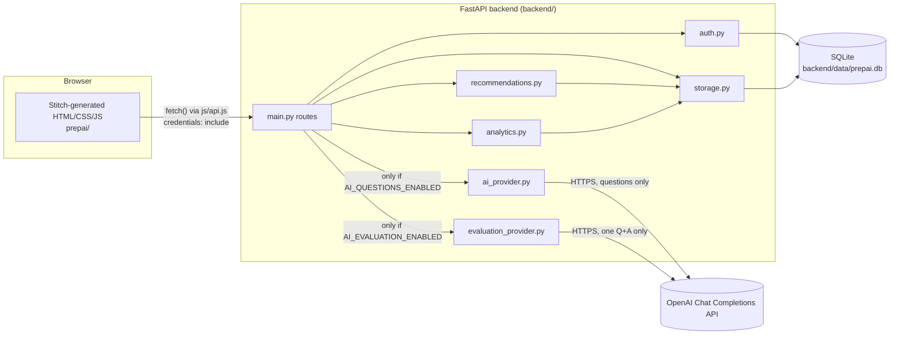
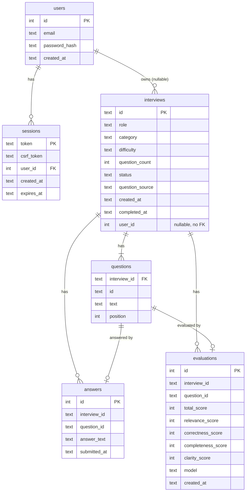

# Architecture and Data Flow

This describes the system as it actually exists in this repository as of
Phase 11 (commit `ebc7493`), verified by reading the code in Phase 12 rather
than by re-describing earlier reports.

## High-level shape



Two independently deployable pieces, talking only over plain HTTP JSON:

- **`prepai/`** - the existing Stitch-generated static frontend. No build
  step, no framework, no bundler. Served by any static file server (VS
  Code Live Server in local development, at `http://127.0.0.1:5500`).
- **`backend/`** - a FastAPI application serving JSON over HTTP at
  `http://127.0.0.1:8000`, backed by a SQLite file.

Nothing about this split changed in Phase 12 - it is preserved exactly as
built in Phases 1-11.

## Frontend layers

Every screen is a standalone HTML file. Fixed script load order (see
`prepai/CLAUDE.md` for full detail):

```
js/icons.js → js/data.js → js/chart.js → [js/api.js] → js/pages.js → js/app.js
```

- **`js/data.js`** - `window.PREP`: the sample dataset and derived helpers.
  Also persists real completed demo attempts to `localStorage`
  (`prepai.demoAttempts`).
- **`js/api.js`** (only on pages that call the backend) - `window.PREP_API`,
  a fetch wrapper. Hardcodes the backend base URL, sends
  `credentials: 'include'` (session cookie) and an `X-CSRF-Token` header
  (read from the non-HttpOnly CSRF cookie) on every non-GET call. Every call
  resolves to `{ ok, status, data }` and never rejects - `status === 0`
  means "network unreachable," distinct from a real HTTP error.
- **`js/pages.js`** - `window.PREP_PAGES`, one render function per screen,
  string-built HTML (no templating engine, an `esc()` helper escapes
  untrusted text).
- **`js/app.js`** - app shell: sidebar, mobile menu, display settings,
  dispatch to the right page function based on `body[data-page]`.
- **`js/chart.js`** / **`js/icons.js`** - dependency-free inline-SVG chart
  and icon helpers.

## Backend routes (`backend/main.py`)

| Route | Purpose |
|---|---|
| `GET /health`, `GET /` | Liveness checks. |
| `POST /api/auth/register`, `/login`, `/logout`, `GET /api/auth/me` | Account/session management. |
| `POST /api/interviews` | Create a session (AI or fixed questions). |
| `GET /api/interviews/{id}` | Read one session (now includes each question's evaluation, if any). |
| `GET /api/interviews` | Paginated list of the caller's own interviews. |
| `POST /api/interviews/{id}/answers` | Submit one answer. |
| `POST /api/interviews/{id}/complete` | Mark a session completed. |
| `POST /api/interviews/{id}/questions/{qid}/evaluate` | AI-score one answered question. |
| `GET /api/recommendations` | Deterministic, rule-based suggestions. |
| `GET /api/analytics` | Account-wide aggregate statistics. |

CORS (`CORSMiddleware` in `main.py`) is restricted to exactly
`http://127.0.0.1:5500`, with `allow_credentials=True` - never a wildcard,
which browsers refuse to combine with credentials.

## Authentication and sessions

- Passwords are hashed with **Argon2id** (`auth.py`, via `argon2-cffi`) -
  never stored or logged in plain text.
- A session is a random opaque token (`secrets.token_urlsafe(32)`) stored in
  the `sessions` table - **not** a JWT, so there is no app-wide signing
  secret. A matching random `csrf_token` is issued alongside it.
- Two cookies: `prepai_session` (`HttpOnly`, carries the session token) and
  `prepai_csrf` (readable by JS, echoed back as `X-CSRF-Token` on
  state-changing requests - the "double-submit cookie" CSRF defense). Both
  `SameSite=Lax`.
- Ownership: an interview created while logged in gets `user_id` set; an
  anonymous interview keeps `user_id = NULL` and stays open to anyone with
  its session ID (unchanged prototype behavior). An owned interview returns
  the same 404 to a non-owner that a nonexistent session would - never a
  403 that would confirm the interview exists.

## Storage layer (`backend/db.py`, `backend/storage.py`)

Plain `sqlite3` (Python standard library, no ORM). `db.connect()` opens a
fresh connection per call, turns on `PRAGMA foreign_keys = ON`, and runs
`CREATE TABLE IF NOT EXISTS` for the whole schema - safe to run repeatedly
against an existing database; it only ever adds missing tables, never drops
or rewrites existing ones.

### Tables



`interviews.user_id` deliberately has **no foreign-key constraint** (only an
index) - SQLite cannot add an FK to an existing table's column without a
full table rebuild, and that rebuild risk was judged worse than enforcing
ownership purely in application code (`main.py`'s `_check_ownership`), which
is where the real security boundary has to live anyway.

See `DATABASE.md` section below for the full persistence story.

## AI question generation vs. AI answer evaluation

These are **two independent features**, each off by default behind its own
environment flag, each calling the same external provider (OpenAI's Chat
Completions API over HTTPS) but for a different purpose:

| | Question generation (`ai_provider.py`) | Answer evaluation (`evaluation_provider.py`) |
|---|---|---|
| Flag | `AI_QUESTIONS_ENABLED` | `AI_EVALUATION_ENABLED` |
| Triggered by | Creating an interview | Clicking "Evaluate with AI" |
| Sends the provider | Role/category/difficulty/count | Role/category/difficulty + one question + one answer |
| Returns | A list of question strings | Four dimension scores + written feedback |
| Trusts the model's arithmetic? | N/A | No - `evaluation_provider.py` sums the four validated dimension scores itself in Python; the model's own total is never used |

**This project calls a pre-trained third-party LLM API (OpenAI) at request
time - it does not train, fine-tune, or host any model itself.** There is no
custom-trained model anywhere in this repository; "AI" here means "one
HTTPS request per action, to an external provider, with the response
strictly schema-validated before use." If either flag is unset (the
default) or the request fails, the backend falls back to the existing fixed
sample question bank (`questions.py`) for generation, or returns a clear
`503` for evaluation - never a silent, fabricated result.

## Rule-based recommendations and analytics

`recommendations.py` and `analytics.py` make **no AI or network calls at
all**. Both are pure Python functions over already-fetched, already
ownership-filtered data (`storage.get_user_recommendation_data`):
deterministic thresholds (e.g. "average category score < 60 is weak") drive
a small ranked list of suggestions, and plain arithmetic (means, maxima,
completion ratios) drives the analytics summary. The same input always
produces the same output - this determinism is what the test suites for
both modules check directly.

## Error handling and offline demo mode

- The backend's global exception handler (`main.py`) returns a generic
  `{"error": "Internal server error."}` on any unhandled exception - never a
  raw traceback or SQL error to the client.
- `js/api.js` never lets a fetch failure throw into page code: every call
  resolves to `{ ok, status, data }`, with `status === 0` meaning "could not
  reach the backend" (network error or timeout) as opposed to a real HTTP
  error code.
- When the backend is unreachable, `practice.html` offers **"Continue in
  Offline Demo Mode"** - an explicit, user-clicked fallback that runs a full
  interview entirely client-side using the fixed sample question bank
  (`js/data.js`), never silently passing off a local-only attempt as a
  server-backed one. The resulting attempt's `source` field (`backend` vs.
  `offline`) records honestly which path actually happened.

---

## Database documentation

**Path:** `backend/data/prepai.db` by default (overridable via the
`DATABASE_PATH` environment variable). Created automatically on first use -
the `data/` folder does not need to exist beforehand. Verified present on
disk in this environment during Phase 12 inspection (a real ~98KB file with
existing interview/account data from prior phases).

**Tables and relationships:** see the ER diagram above. In summary:
`users` → `sessions` (1-to-many, cascading delete) and `users` → `interviews`
(1-to-many via a plain indexed column, no FK, nullable for anonymous
interviews); `interviews` → `questions` → `answers`/`evaluations` (all
cascading via foreign keys scoped to `(interview_id, id)` pairs, so a
question ID like `q1` is only unique within its own interview).

**What survives a restart:** everything in the database file - interview
sessions, their questions, submitted answers, saved evaluations, registered
users, and active (unexpired) sessions. Nothing about this project keeps
request-scoped state in memory between requests; every backend function
opens a fresh SQLite connection, does one unit of work, and closes it. This
was directly re-verified in Phase 12 by running the full `pytest` suite
(including `tests/test_storage.py::test_session_survives_simulated_restart`)
and by stopping and restarting the real backend process.

**User ownership vs. anonymous records:** `interviews.user_id` is `NULL` for
any interview created without being logged in - these stay visible to
anyone holding the session ID, exactly as before accounts existed. An owned
interview (`user_id` set) is only ever returned to its own account; every
other route checks ownership and returns the same 404 a nonexistent ID
would otherwise give.

**How tests isolate their database:** `backend/tests/conftest.py` points
every test run at its own fresh temporary database file (not
`backend/data/prepai.db`), so running `pytest` never reads, writes, or
pollutes the real development database. This was confirmed by running the
suite and observing `backend/data/prepai.db`'s file size/contents are
untouched by a test run.

**Making a safe local backup:**

```powershell
# Stop the backend first - copying a SQLite file while it's open for
# writes can capture an inconsistent snapshot.
copy "backend\data\prepai.db" "backend\data\prepai.db.bak"
```

**Restoring a backup safely:**

```powershell
# Stop the backend first.
copy "backend\data\prepai.db.bak" "backend\data\prepai.db"
# Start the backend again - it will open the restored file as-is.
```

Never restore over a running backend's open database file, and never use
this to "reset" a database that still holds real data you want to keep -
copy it aside first if you're unsure.

**Moving to a hosted PostgreSQL database (future work, not done this
phase):** would require: (1) replacing `db.py`'s raw `sqlite3` connection
logic with a PostgreSQL driver/connection pool (e.g. `psycopg`), since the
current code is SQLite-specific (`PRAGMA foreign_keys`, SQLite's
`CREATE TABLE IF NOT EXISTS` dialect); (2) adding the `interviews.user_id`
foreign key for real this time (PostgreSQL supports adding FKs to existing
tables without the rebuild SQLite requires); (3) a migration tool (e.g.
Alembic) instead of the current ad-hoc `CREATE TABLE IF NOT EXISTS` schema
management, since hand-written schema changes do not scale past "only ever
add columns/tables"; (4) connection pooling, since PostgreSQL connections
are more expensive to open per-request than SQLite's; (5) a one-time data
migration script to copy existing SQLite rows into PostgreSQL if existing
local data needs to be preserved. None of this was attempted in Phase 12 -
it is a deployment-readiness item, not a local-prototype requirement.
